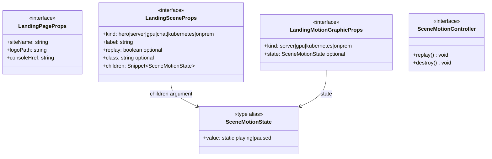

# `frontend/src/lib/components/landing` 클래스 다이어그램

**대상 경로:** `frontend/src/lib/components/landing`

## 책임

공개 연구 클라우드 랜딩의 외부 props와 설명용 장면의 motion 계약을 정의한다. 장면은 실제 자원·진행 상태가 아니며, 기존 콘솔 목적지와 서비스 가이드에 연결한다. 이 문서는 현재 다섯 source type과 두 정적 타입 관계를 보여준다.

## 포함 파일

- `frontend/src/lib/components/landing/LandingPage.svelte`
- `frontend/src/lib/components/landing/LandingScene.svelte`
- `frontend/src/lib/components/landing/LandingMotionGraphic.svelte`
- `frontend/src/lib/components/landing/sceneMotion.ts`

## 타입 관계

`SceneMotionController`는 `createSceneMotion(node, onstate)`가 생성하고 `LandingScene`이 보유한다. viewport/document visibility는 같은 유한 animation의 재생·정지를 제어한다. 모든 phase가 끝나거나 reduced motion이 활성화되면 완성된 static 장면이 된다. 완료 장면은 다시 진입해도 자동 재생하지 않고 명시적 replay만 새 timeline을 시작한다. Destroy 이후 늦은 observer callback은 무시한다.
