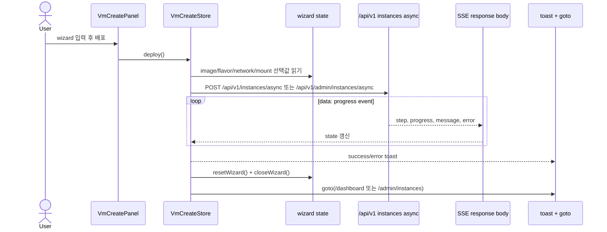
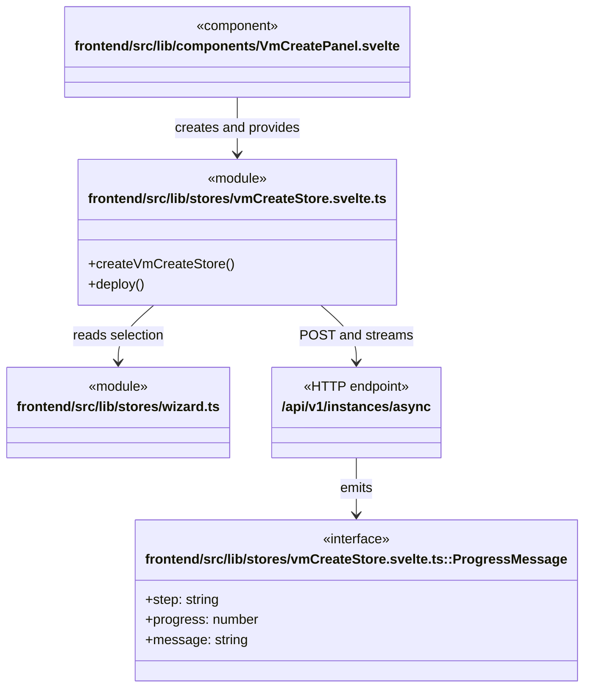

# VM 생성 workflow

**진입점:** `frontend/src/lib/components/VmCreatePanel.svelte`는 `createVmCreateStore()`를 만들고 wizard context에 제공한다. `VmCreateStore.deploy()`는 사용자 또는 관리자 일반 VM 생성과 SSE 진행 상태를 담당한다. 공개 squashfs/library consume와 비동작 HA 선택은 제거했으며 독립 관리자 Palimpsest 빌드·소비는 이 wizard 밖에 있다.

## Sequence

## 시나리오 클래스

## 근거

- `vmCreateStore.svelte.ts::deploy`는 일반 경로에서 `/api/v1/instances/async` 또는 `/api/v1/admin/instances/async`에 `fetch` POST하고 SSE-like `data:` line을 소비한다.
- 일반 VM 입력은 이미지/기존 부팅 볼륨, flavor·network·SSH·GPU·직접 데이터 mount를 유지하며 library/squashfs consume와 HA payload를 보내지 않는다.
- 완료 시 wizard reset/close와 `goto()`를 수행한다.
